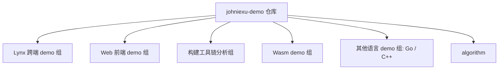

# 系统架构

> 本文档是 johniexu-demo 的架构说明，随仓库演进持续更新。

## 项目概述

johniexu-demo 是一个多技术栈 demo 试验场：包含一系列用于测试、原理分析、方案验证的独立小项目，持续更新。根目录无统一构建配置，每个子目录是自包含项目。

## 技术栈

| 子项目 | 技术栈 | 备注 |
|--------|--------|------|
| lynx-demo / lynx-refresh-bug / diy-mcp | rspeedy + @lynx-js/react + pnpm workspace | Lynx 跨端方案验证 |
| lynx-web-demo / lynx-android-demo / lynx-macos-demo / lynx-windows-demo / lynx-windows-cmake-demo / lynx-stack | Lynx 各平台宿主验证 | Web/Android/macOS/Windows |
| lit-demo | Lit 组件开发 | 参考 spectrum-web-components |
| quill-editor | Vue + 富文本编辑器 | 多种编辑器对比 |
| webpack / webpack-project-base / babel / babel-plugin-import-demo / bundler-tools | webpack / babel 自定义配置与插件 loader | 构建工具链分析 |
| nuxt-babel | nuxt 自定义配置 | |
| webassembly / dominantcolor_demo / assemblyscript_demo | Go / AssemblyScript → Wasm | |
| go-web-demo / grpc-demo | Go / gRPC | |
| cpp-demo | C++ | |
| mobile-layout | 移动端自适应布局验证 | |
| tsdoc-demo / tsconfig-paths / trae-demo / uipro-demo / johniexu-demo / westore-demo / expo-app-demo / git / diy-mcp | 各专项验证 | 详见根 README 项目列表 |

## 目录职责

- `lynx-*`：Lynx 跨端容器及原生壳工程验证
- `webpack*` / `babel*` / `bundler-tools`：构建工具链原理分析
- `webassembly` / `assemblyscript_demo` / `dominantcolor_demo`：Wasm 模块验证（含 Go 实现获取图片主色调）
- `algorithm`：手写基本算法
- `assets`：仓库静态资源

## 架构拓扑

> 各子项目之间无运行时依赖，仅在部分 pnpm workspace（lynx-demo、lynx-refresh-bug、diy-mcp）内部存在 workspace 依赖。

## 质量门命令

无仓库级统一质量门。进入各子目录后按该子项目 package.json 的 scripts 执行（如 lynx-demo：`pnpm lint` / `pnpm test` / `pnpm build`）。
