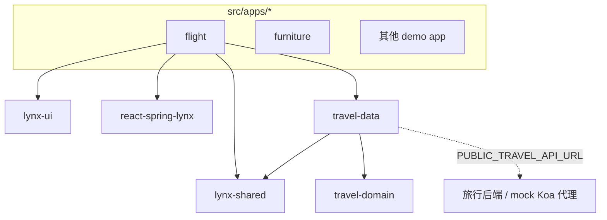

# 系统架构

> 本文档是 lynx-demo 的架构说明。API/DDD 分层详见 `travel-api-architecture.md`，monorepo 拆分计划详见 `monorepo-plan.md`。

## 项目概述

基于 ReactLynx + Rspeedy 的多入口 demo monorepo：根工程承载多个相互独立的 demo app（`src/apps/*` 自动扫描成 entry），共享 workspace 包（UI 组件、动画、fetch 封装、DDD 分层的数据/领域层）。

## 技术栈

| 类别 | 依赖 | 版本 |
|------|------|------|
| 框架 | @lynx-js/react | ^0.120.0 |
| 构建 | @lynx-js/rspeedy + react-rsbuild-plugin + qrcode-rsbuild-plugin | ^0.14.3 / ^0.16.1 / ^0.4.6 |
| 路由 | @tanstack/react-router + react-router | ^1.170.3 / ^6.30.3 |
| 状态 | zustand | ^5.0.13 |
| 动画 | @react-spring/web + react-spring-lynx（workspace 适配器） | ^10.0.3 |
| 样式 | tailwindcss + sass/sass-embedded + postcss-px-to-viewport-8-plugin | ^3.4.19 / 1.80.6 / ^1.2.5 |
| 测试 | vitest + jsdom + @testing-library/jest-dom | ^3.2.4 |
| 类型 | typescript + @lynx-js/types | ~5.9.3 / 3.8.0 |
| Mock | koa + @koa/router（mock/server.mjs） | ^2.15.3 / ^12.0.1 |

## 目录职责

- `src/apps/*`：独立 demo app（flight / furniture / bouncescroll / cssunit / darkmode / travel-auth 等），每个含 `index.tsx` 的目录即一个构建 entry
- `src/animations/`：共享动画 hooks 与预设（gentle / stiff / wobbly / swift）
- `src/components/`、`src/utils/`：跨 app 共享组件与工具
- `packages/lynx-shared`：fetch 封装、hooks、平台工具
- `packages/lynx-ui`：可复用 UI 组件库
- `packages/react-spring-lynx`：React Spring 的 Lynx 动画适配
- `packages/travel-domain`：纯领域层（零外部依赖）
- `packages/travel-data`：数据层（依赖 travel-domain + lynx-shared）
- `mock/`：Koa 调试代理 / mock 服务器
- `docs/`：架构文档与 retro 复盘

## 架构拓扑



## 关键机制

- **多入口**：`lynx.config.ts` 扫描 `src/apps/` 生成 entry，经 `?entry=<name>` 访问
- **双线程**：后台线程 React 渲染 + 主线程（MTS）高频交互直改样式
- **react-shim**：`src/react-shim.ts` 将 react 导入映射到 `@lynx-js/react`
- **响应式**：postcss px→vw，按 `RESPONSIVE_APPS` 白名单启用，基线 375
- **Web bundle**：`EXPERIMENTAL_USE_WEB_BINARY_TEMPLATE=false` 输出 JSON 格式 web bundle

## 质量门命令

```bash
pnpm lint    # eslint .
pnpm test    # vitest run
pnpm build   # rspeedy build
```
